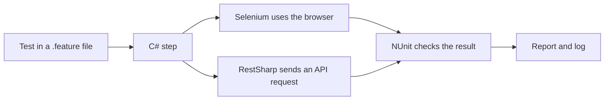

# Web_API_Automation

This project runs automated tests with C# and .NET 8. **UI tests** use a browser to check things a person can do on a web page. **API tests** send requests directly to a web service and check the replies. You can run both sets of tests together and see the results in one report.

## Contents

- [Run the tests](#run-the-tests)
- [Open the report](#open-the-report)
- [What the tests cover](#what-the-tests-cover)
- [How the code works](#how-the-code-works)
- [Change test settings](#change-test-settings)
- [Check results on GitHub](#check-results-on-github)
- [Add a test](#add-a-test)

## Run the tests

1. Install the **.NET 8 SDK**.
2. Open PowerShell in the folder that contains `Web_API_Automation.sln`. Keep an internet connection for downloading packages, setting up the browser and its driver, and reaching the demo sites.
3. Choose the tests you want to run.

### Run all tests

```powershell
dotnet test Web_API_Automation.sln
```

### Run only browser tests

```powershell
dotnet test AutomationTests/AutomationTests.csproj --filter "TestCategory=ui"
```

### Run tests tagged advanced

```powershell
dotnet test AutomationTests/AutomationTests.csproj --filter "TestCategory=advanced"
```

### Run only API tests

```powershell
dotnet test AutomationTests/AutomationTests.csproj --filter "TestCategory=API"
```

### Run authentication and authorization tests

```powershell
dotnet test AutomationTests/AutomationTests.csproj --filter "TestCategory=authentication"
```

You can also open the solution in Visual Studio and run the tests from **Test Explorer**. [Web_API_Automation.sln](Web_API_Automation.sln)

## Open the report

After the run finishes, enter this command in PowerShell from the same folder. It opens the report in your default browser. [Open-Report.ps1](AutomationTests/Open-Report.ps1)

```powershell
.\AutomationTests\Open-Report.ps1
```

The default report file is `AutomationTests/Reports/Automation Execution Results.html`. If you set `REPORTS_DIR` before running the tests, use the same setting when you open the report.

### Read the results

- Open **Tests**. Click **UI** or **API** to show or hide that group's results. You can also use the tag icon to filter by group.
- Click a test to see each step, its result, and how long it took. Expand **Screenshot** under a browser step or **HTTP details** under an API step. When a browser alert prevents a screenshot, the report shows the alert text and the last image it captured, when available.

| File | What it contains |
| --- | --- |
| `Automation Execution Results.html` | Test results, step details, browser screenshots, and API request or response details. [ExtentReport.cs](AutomationReporting/ExtentReport.cs) |
| `automation.log` | A record of what happened during the run, including browser setup, API requests, and retries. [Logger.cs](AutomationReporting/Logger.cs) |
| `*.png` | A separate screenshot attached to a failed browser test when the browser can capture one. |
| `*.trx` | A file that test tools read. It is saved when you use the TRX logger option. |

## What the tests cover

### Browser tests

The 33 browser tests exercise 32 examples on The Internet. For example, the table test checks a column heading, and the calendar test checks that you can pick a date. [The Internet](https://the-internet.herokuapp.com/)

| Test file | What it checks | C# files |
| --- | --- | --- |
| [Login.feature](AutomationTests/UI/Features/Login.feature) | A correct password signs you in. An incorrect password shows an error. | [LoginSteps.cs](AutomationTests/UI/StepDefinitions/LoginSteps.cs), [LoginPage.cs](AutomationTests/UI/Pages/LoginPage.cs) |
| [DynamicLoading.feature](AutomationTests/UI/Features/DynamicLoading.feature) | Clicking **Start** in the second example shows a message after a delay. | [DynamicLoadingSteps.cs](AutomationTests/UI/StepDefinitions/DynamicLoadingSteps.cs), [DynamicLoadingPage.cs](AutomationTests/UI/Pages/DynamicLoadingPage.cs) |
| [BrowserControls.feature](AutomationTests/UI/Features/BrowserControls.feature) | Dropdowns, checkboxes, adding and removing a button, browser dialogs, right-click, hover, a slider, drag and drop, frames, windows, Shadow DOM, a table heading, file upload, and modern file download. | [BrowserControlSteps.cs](AutomationTests/UI/StepDefinitions/BrowserControlSteps.cs), [BrowserControlsPage.cs](AutomationTests/UI/Pages/BrowserControlsPage.cs) |
| [AdvancedControls.feature](AutomationTests/UI/Features/AdvancedControls.feature) | Radio buttons, selecting several options, a custom dropdown, autocomplete, picking a date, typing into a field after it becomes enabled, finding an item after the page replaces it, swiping, and holding a button. | [AdvancedControlsSteps.cs](AutomationTests/UI/StepDefinitions/AdvancedControlsSteps.cs), [AdvancedControlsPage.cs](AutomationTests/UI/Pages/AdvancedControlsPage.cs) |
| [AdvancedInteractions.feature](AutomationTests/UI/Features/AdvancedInteractions.feature) | Form validation, remembering a cookie choice, loading new content on scroll, and signing in with the demo's one-time code. | [AdvancedInteractionsSteps.cs](AutomationTests/UI/StepDefinitions/AdvancedInteractionsSteps.cs), [AdvancedInteractionsPage.cs](AutomationTests/UI/Pages/AdvancedInteractionsPage.cs) |
| [EmbeddedControls.feature](AutomationTests/UI/Features/EmbeddedControls.feature) | Advanced iframes, controls inside nested and closed Shadow DOM, and editing and formatting text in TinyMCE. | [EmbeddedControlsSteps.cs](AutomationTests/UI/StepDefinitions/EmbeddedControlsSteps.cs), [EmbeddedControlsPage.cs](AutomationTests/UI/Pages/EmbeddedControlsPage.cs) |
| [BrowserPermissions.feature](AutomationTests/UI/Features/BrowserPermissions.feature) | Checks that the demo page reports denied location access when the test browser blocks it. | [BrowserPermissionsSteps.cs](AutomationTests/UI/StepDefinitions/BrowserPermissionsSteps.cs) |

### API tests

The 21 API tests check web service replies and access to protected reports. HTTPBingo returns request details, and The Internet lets our tests check HTTP status codes such as `200` for success and `404` for a missing page. The 15 access tests use a local test handler with sample credentials and tokens. [HTTPBingo](https://httpbingo.org/) · [The Internet status codes](https://the-internet.herokuapp.com/status_codes)

| Test file | What it checks | C# file |
| --- | --- | --- |
| [HttpMethods.feature](AutomationTests/API/Features/HttpMethods.feature) | HTTPBingo returns the GET method and query value, or the method and JSON data sent with POST, PUT, and PATCH. | [APIHandlingSteps.cs](AutomationTests/API/StepDefinitions/APIHandlingSteps.cs) |
| [StatusCodes.feature](AutomationTests/API/Features/StatusCodes.feature) | The Internet returns the expected code, either `200` or `404`. | [StatusCodeSteps.cs](AutomationTests/API/StepDefinitions/StatusCodeSteps.cs) |
| [ApiAuthentication.feature](AutomationTests/API/Features/ApiAuthentication.feature) | Basic login, OAuth 2.0 token requests, and signed JWTs. Checks access with valid credentials, invalid or missing credentials, and valid credentials with too little permission. | [ApiAuthenticationSteps.cs](AutomationTests/API/StepDefinitions/ApiAuthenticationSteps.cs), [AuthenticationTestHandler.cs](AutomationTests/API/Support/AuthenticationTestHandler.cs) |

## How the code works

### Follow one test

1. A **scenario** is one test case in a `.feature` file. `Given` describes the starting point, `When` describes what to do, and `Then` describes what should happen. A `Scenario Outline` runs once for each row in its `Examples` table.
2. Reqnroll connects each line to a C# method called a **step definition**. NUnit runs the tests and checks their expected results.
3. In a browser test, the step calls a **page object**. This is a C# class that knows how to find and use the controls on a page. In an API test, the step sends a request through `ApiClient` and checks the reply.
4. `TestHooks` sets up each test and records its results. `ScenarioSession` starts a browser for each UI test, closes it when the test ends, and removes any temporary download folder. [TestHooks.cs](AutomationTests/Hooks/TestHooks.cs) · [ScenarioSession.cs](AutomationTests/Hooks/ScenarioSession.cs)



### What each project does

| Project | Purpose |
| --- | --- |
| [AutomationTests](AutomationTests/AutomationTests.csproj) | Holds the test cases, C# steps, page objects, sample files, and setup code. |
| [AutomationFramework](AutomationFramework/AutomationFramework.csproj) | Holds shared Selenium code for starting a browser, finding controls, clicking, typing, and waiting. |
| [ApiAutomation](ApiAutomation/ApiAutomation.csproj) | Sends HTTP requests with RestSharp and uses Polly to retry certain requests. |
| [AutomationReporting](AutomationReporting/AutomationReporting.csproj) | Writes the HTML report with ExtentReports and the text log with Serilog. |

### Shared browser code

Selenium uses a **driver** to control Chrome or Firefox. When tests first need a browser, Selenium Manager finds the current stable version and a driver that works with it. WebDriverManager sets up that driver in `~/.cache/seleniumautomation/drivers`. [DriverFactory.cs](AutomationFramework/Drivers/DriverFactory.cs)

Each browser test starts with a fresh profile. The Chrome test profile turns off password prompts so Selenium can complete the demo sign-in.

| File | What it does |
| --- | --- |
| [AdvancedControl.cs](AutomationFramework/AdvancedControl.cs) | Switches into frames and back, finds controls inside nested Shadow DOM, reads form validation and permission states, waits for cookies, and loads more items by scrolling. |
| [PageObject.cs](AutomationFramework/UI/PageObject.cs) | Gives page classes common tools for opening pages and working with controls. |
| [ElementActions.cs](AutomationFramework/UI/ElementActions.cs) | Finds and uses controls, reads tables, and helps upload files. Polly retries selected actions up to twice, finding the element again each time. |
| [WaitHelper.cs](AutomationFramework/Utilities/WaitHelper.cs) | Waits for something to happen, such as a button becoming visible or enabled. The default wait is 15 seconds. |
| [BrowserActions.cs](AutomationFramework/UI/BrowserActions.cs) | Works with tabs, frames, alerts, scrolling, screenshots, and HTML drag and drop. |
| [InputActions.cs](AutomationFramework/UI/InputActions.cs) | Sends keyboard, mouse, and scroll actions such as right-click and holding down a button. |
| [DownloadActions.cs](AutomationFramework/UI/DownloadActions.cs) | Waits for a file to finish downloading before a test reads it. |
| [ConfigHelper.cs](AutomationFramework/Utilities/ConfigHelper.cs) | Reads the browser name and whether to show the browser window. |

### Shared API code

`ApiClient` takes a RestSharp `RestRequest` and returns the response. It supports GET, POST, PUT, and PATCH. Each attempt has a 30-second timeout. A caller can pass a `CancellationToken` to stop the request or the wait before a retry. The log uses a request ID so you can find its retry messages and final result. [ApiClient.cs](ApiAutomation/Clients/ApiClient.cs)

A **retry** means trying the request again after a temporary problem.

- Polly can retry GET and PUT requests without attachments up to twice. POST, PATCH, and requests with file attachments use one attempt.
- Polly retries after certain connection errors, timeouts, or HTTP codes `408`, `429`, `500`, `502`, `503`, and `504`.
- It usually waits 250 ms before the first retry and 500 ms before the second. If the server sends a `Retry-After` wait of up to five seconds, Polly uses it. For a longer wait, the client returns the response. [ApiClient.cs](ApiAutomation/Clients/ApiClient.cs)

### API authentication and authorization

Authentication checks who is making the request. Authorization checks what that caller is allowed to do. The tests expect `200` when access is allowed, `401` when credentials are missing or invalid, and `403` when a valid caller lacks permission.

| Method | How to use it |
| --- | --- |
| Basic | Call `WithBasic(username, password)` on a request to send the username and password in the Authorization header. [ApiAuthentication.cs](ApiAutomation/Authentication/ApiAuthentication.cs) |
| OAuth 2.0 | Use `OAuth2TokenClient` to exchange a client ID and secret for an access token. This is the **client credentials** flow for service-to-service calls. Attach the token to the next request with `WithOAuth2(accessToken)`. [OAuth2TokenClient.cs](ApiAutomation/Authentication/OAuth2TokenClient.cs) |
| JWT | Call `WithJwt(jwt)` to send a signed token from your service as a Bearer token. The test handler checks the signature, expiration, issuer, audience, and report permission. [ApiAuthentication.cs](ApiAutomation/Authentication/ApiAuthentication.cs) |

Each helper adds credentials to one request. Use HTTPS and supply real credentials from your environment or secret store when you connect to a real service. The test report records the scheme and result without including credentials or token values.

### Test settings and sample files

| File | What it does |
| --- | --- |
| [TestSettings.cs](AutomationTests/Configuration/TestSettings.cs) | Stores the address of The Internet and reads the login test data. |
| [testdata.json](AutomationTests/UI/TestData/testdata.json) | Holds the public demo login details and a wrong password for the sign-in tests. |
| [upload-example.txt](AutomationTests/UI/TestData/upload-example.txt) | Gives the upload test a sample file to send. |
| [AssemblyInfo.cs](AutomationTests/Properties/AssemblyInfo.cs) | Lets NUnit run tests at the same time and sets the default to two workers. |
| [Reports/.gitkeep](AutomationTests/Reports/.gitkeep) | Keeps the reports folder in Git so it is present when you clone the repo. |

## Change test settings

| Setting | Default | What it changes |
| --- | --- | --- |
| `BROWSER` | `chrome` | Choose `chrome` or `firefox` for browser tests. |
| `HEADLESS` | `true` | Set it to `false` to see the browser window while the tests run. |
| `REPORTS_DIR` | `AutomationTests/Reports` | Choose where to save the HTML report, log, and screenshots. |
| `NUnit.NumberOfTestWorkers` | `2` | Choose how many tests can run at the same time. |

### Watch Firefox run the tests

```powershell
$env:BROWSER = "firefox"
$env:HEADLESS = "false"
$env:REPORTS_DIR = Join-Path $PWD "AutomationTests/Reports"
dotnet test AutomationTests/AutomationTests.csproj --filter "TestCategory=ui" --logger "trx;LogFileName=selenium.trx" --results-directory $env:REPORTS_DIR
```

### Change how many tests run at once

Run all tests one at a time, or allow up to four browser tests at once.

```powershell
dotnet test Web_API_Automation.sln -- NUnit.NumberOfTestWorkers=1
dotnet test AutomationTests/AutomationTests.csproj --filter "TestCategory=ui" -- NUnit.NumberOfTestWorkers=4
```

## Check results on GitHub

GitHub Actions runs the tests on pull requests and pushes to `main`. You can also start a run yourself from the **Actions** tab. Open the run and look under **Artifacts** to download the report and logs.

| File | What it checks |
| --- | --- |
| [selenium-ci.yml](.github/workflows/selenium-ci.yml) | Runs the 33 browser tests on Chrome and Firefox in separate jobs. The results are available as `selenium-chrome` and `selenium-firefox`. |
| [api-ci.yml](.github/workflows/api-ci.yml) | Runs all 21 API tests. The results are available as `restsharp-api`. |
| [verify-parallel-results.py](.github/scripts/verify-parallel-results.py) | Checks that the expected number of tests passed and that at least two passing tests ran at the same time. |

Git skips files that the tools create, such as reports, build files, test results, and generated C# files. [.gitignore](.gitignore)

## Add a test

1. Add a scenario under `AutomationTests/UI/Features` for a browser test or `AutomationTests/API/Features` for an API test. Use the `@ui` or `@API` tag for the correct group.
2. Reuse an existing C# step if it matches. For a new browser step, put the code that finds and uses controls in a page object. For a new API step, use `ApiClient` to send the request.
3. Run the group you changed and open the report. If you added or removed a test, update the expected test count in the matching GitHub Actions file.
