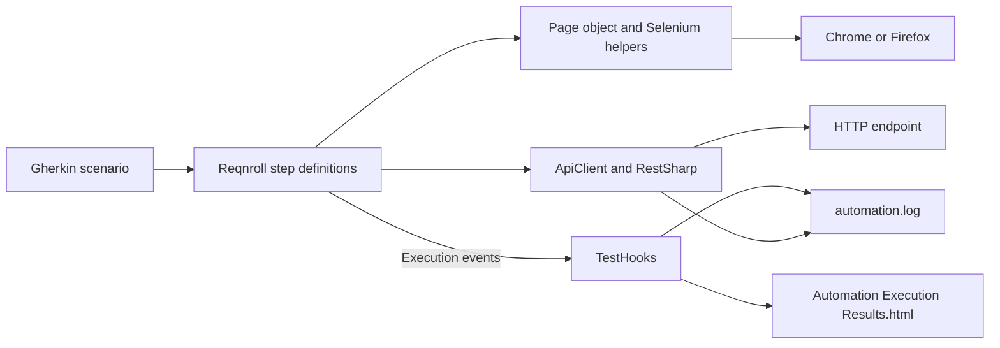

# Web_API_Automation

A C# and .NET 8 test suite for browser behavior and HTTP APIs. Start with the human-readable `.feature` files to see what each test checks. Follow their step definitions to the C# code that performs the actions and verifies the results.

The browser scenarios use The Internet, a public website with examples of common web controls. The API scenarios use its status-code endpoints and HTTPBingo, which echoes requests so the tests can verify what the server received. [The Internet](https://the-internet.herokuapp.com/) · [HTTPBingo](https://httpbingo.org/)

## Run the tests

Install the .NET 8 SDK and run these commands from the repository root. NuGet restore, browser and driver provisioning, and calls to the demo sites require network access.

```powershell
dotnet test Web_API_Automation.sln
dotnet test AutomationTests/AutomationTests.csproj --filter "TestCategory=ui"
dotnet test AutomationTests/AutomationTests.csproj --filter "TestCategory=http"
```

The first command runs both suites. The other commands select the UI or API scenarios. You can also open the solution in Visual Studio and run scenarios in Test Explorer. [Web_API_Automation.sln](Web_API_Automation.sln)

After a run, open `AutomationTests/Reports/Automation Execution Results.html` for the scenario results and `AutomationTests/Reports/automation.log` for the detailed log. The solution-wide command puts both suites in one HTML report. In the **Tests** view, results appear below the **UI** heading first, followed by the results below **API**. Select either heading to collapse or expand its results. Select a scenario to see its BDD steps, or use the tag icon to filter by category. Expand **Screenshot** below a UI step or **HTTP details** below an API step to inspect its evidence.

## How the projects fit together

| Project | Responsibility |
| --- | --- |
| [AutomationTests](AutomationTests/AutomationTests.csproj) | Defines the behavior to test, connects Gherkin steps to C# code, and uses NUnit to verify results. Reqnroll and the NUnit test adapter make the scenarios discoverable by `dotnet test` and Test Explorer. The project also copies UI test data into the test output and records the project location for default reporting. |
| [AutomationFramework](AutomationFramework/AutomationFramework.csproj) | Provides reusable Selenium browser setup, page objects, element interactions, and waits. Selenium.Support supplies utilities such as explicit waits and dropdown selection. WebDriverManager sets up driver binaries, and Polly.Core supplies retries for selected UI actions. |
| [ApiAutomation](ApiAutomation/ApiAutomation.csproj) | Provides the HTTP client. RestSharp builds and sends requests, and Polly handles retries for eligible requests. |
| [AutomationReporting](AutomationReporting/AutomationReporting.csproj) | Produces the ExtentReports HTML report and provides the shared Serilog file logger used by both UI and API code. |



## How a scenario runs

1. **Discovery.** Reqnroll turns each Gherkin `Scenario` into a test that NUnit can run. A `Scenario Outline` runs once for each row in its `Examples` table. `Given` describes the starting state, `When` describes an action, and `Then` describes the expected result. `And` continues the preceding kind of step.
2. **Setup.** `TestHooks` starts the logger for the test run and creates a report entry for each scenario. A scenario tagged `@ui` starts its own browser. A UI scenario tagged `@download` also gets a temporary download directory. API scenarios tagged `@http` call HTTP endpoints directly. [TestHooks.cs](AutomationTests/Hooks/TestHooks.cs)
3. **Execution.** A step definition is a C# method associated with a Gherkin sentence. In the valid-login test, `LoginSteps` reads the demo test data and calls `LoginPage.SignIn`. The page object finds the fields and submits the form, and the step definition checks for the secure area and success message. In the API status-code test, `StatusCodeSteps` sends a GET request and checks the returned status against the example value, including the expected `404`.
4. **Reporting and cleanup.** The hooks record each step’s result and screenshot or HTTP details as it finishes. A failed browser scenario can also save a separate screenshot for the test runner. `ScenarioSession` closes the browser and removes its temporary download directory. The run-level hook flushes the report and log when the run ends. [ScenarioSession.cs](AutomationTests/Hooks/ScenarioSession.cs)

## Test files and coverage

Each UI feature describes the behavior in Gherkin. Its **step definitions** run the actions and assertions. Its **page object** keeps the page’s locators, navigation, and interactions together, so a selector change can be made in one place.

| UI feature | C# files | What the scenarios check |
| --- | --- | --- |
| [Login.feature](AutomationTests/UI/Features/Login.feature) | [LoginSteps.cs](AutomationTests/UI/StepDefinitions/LoginSteps.cs), [LoginPage.cs](AutomationTests/UI/Pages/LoginPage.cs) | Valid demo credentials reach the secure area, and an incorrect password produces the expected error. |
| [DynamicLoading.feature](AutomationTests/UI/Features/DynamicLoading.feature) | [DynamicLoadingSteps.cs](AutomationTests/UI/StepDefinitions/DynamicLoadingSteps.cs), [DynamicLoadingPage.cs](AutomationTests/UI/Pages/DynamicLoadingPage.cs) | A message becomes visible after clicking Start and waiting for the page to render it. |
| [BrowserControls.feature](AutomationTests/UI/Features/BrowserControls.feature) | [BrowserControlSteps.cs](AutomationTests/UI/StepDefinitions/BrowserControlSteps.cs), [BrowserControlsPage.cs](AutomationTests/UI/Pages/BrowserControlsPage.cs) | Dropdowns, checkboxes, elements added or removed by the page, dialogs, right-click and hover behavior, a keyboard-controlled slider, HTML5 drag and drop, nested frames, new windows, shadow DOM, table headers, and file uploads and downloads. |
| [AdvancedControls.feature](AutomationTests/UI/Features/AdvancedControls.feature) | [AdvancedControlsSteps.cs](AutomationTests/UI/StepDefinitions/AdvancedControlsSteps.cs), [AdvancedControlsPage.cs](AutomationTests/UI/Pages/AdvancedControlsPage.cs) | Radio buttons, multiple selections, custom dropdowns, autocomplete, a calendar, an input that becomes enabled later, an element replaced in the page, and swipe and long-press gestures. |

| API feature | C# file | What the scenarios check |
| --- | --- | --- |
| [HttpMethods.feature](AutomationTests/API/Features/HttpMethods.feature) | [HttpMethodSteps.cs](AutomationTests/API/StepDefinitions/HttpMethodSteps.cs) | HTTPBingo echoes the GET method and query parameter, and echoes the method and JSON payload for POST, PUT, and PATCH. |
| [StatusCodes.feature](AutomationTests/API/Features/StatusCodes.feature) | [StatusCodeSteps.cs](AutomationTests/API/StepDefinitions/StatusCodeSteps.cs) | The Internet returns the requested example status code, either `200` or `404`. |

| Shared test file | Purpose |
| --- | --- |
| [TestSettings.cs](AutomationTests/Configuration/TestSettings.cs) | Holds the base URL for The Internet and reads the copied login test data. The HTTPBingo URL lives in `HttpMethodSteps.cs`. |
| [testdata.json](AutomationTests/UI/TestData/testdata.json) | Supplies the public demo account and the intentionally incorrect password for the login scenarios. |
| [upload-example.txt](AutomationTests/UI/TestData/upload-example.txt) | Supplies the sample file for the upload scenario to submit and verify. |
| [TestHooks.cs](AutomationTests/Hooks/TestHooks.cs) | Connects reporting, logging, browser setup, step timing, screenshots, and cleanup to the Reqnroll test lifecycle. |
| [ScenarioSession.cs](AutomationTests/Hooks/ScenarioSession.cs) | Owns one UI scenario’s live driver and optional temporary download directory. Supplies the same driver to that scenario’s page objects and hooks. |
| [AssemblyInfo.cs](AutomationTests/Properties/AssemblyInfo.cs) | Enables NUnit parallel execution for child tests and sets the default worker count to two. |
| [Reports/.gitkeep](AutomationTests/Reports/.gitkeep) | Keeps the empty reports folder visible in a fresh checkout. The reporter and logger create the output directory when the tests run. |

## Browser setup and reusable UI helpers

`DriverFactory` selects Chrome or Firefox and applies the browser’s headless and download settings. On the first request for a browser in a test process, Selenium Manager checks the latest stable release, prepares the browser, and resolves a compatible driver version. The WebDriverManager NuGet package sets up that driver in `~/.cache/seleniumautomation/drivers`. The factory reuses the resolved browser and driver paths within the process and starts a fresh browser session for each UI scenario. [DriverFactory.cs](AutomationFramework/Drivers/DriverFactory.cs)

The four page classes inherit `PageObject`, which supplies shared navigation and element helpers. Those helpers use Selenium’s `IWebDriver` interface, so the same page and step code works with Chrome and Firefox.

| File | Responsibility |
| --- | --- |
| [ConfigHelper.cs](AutomationFramework/Utilities/ConfigHelper.cs) | Reads the `BROWSER` and `HEADLESS` environment variables used by the factory and scenario setup. |
| [WaitHelper.cs](AutomationFramework/Utilities/WaitHelper.cs) | Polls for an explicit condition such as an element becoming visible, enabled, hidden, or detached. The default timeout is 15 seconds. |
| [PageObject.cs](AutomationFramework/UI/PageObject.cs) | Gives each page object browser and element helpers tied to the active driver, and resolves page paths against the configured base URL. |
| [ElementActions.cs](AutomationFramework/UI/ElementActions.cs) | Locates elements, clicks and types, changes selections, reads text and DOM properties, handles shadow roots and tables, and sends files to upload controls. Selected actions and reads retry up to twice after transient Selenium interaction errors. Each retry locates the element again so a page redraw can recover. |
| [BrowserActions.cs](AutomationFramework/UI/BrowserActions.cs) | Navigates pages, manages frames and windows, handles alerts and prompts, runs JavaScript, dispatches HTML5 drag events, scrolls, and captures screenshots. |
| [InputActions.cs](AutomationFramework/UI/InputActions.cs) | Builds Selenium keyboard, pointer, and wheel action sequences. Use `Perform` for a custom Selenium Actions sequence and `PerformSequences` for low-level device actions. |
| [DownloadActions.cs](AutomationFramework/UI/DownloadActions.cs) | Waits for the expected download in the scenario’s temporary folder. It checks for common partial-file extensions and can wait for a minimum file size before the test reads the contents. |

## API requests and retries

`ApiClient` accepts a configured RestSharp `RestRequest` or a resource path and `HttpMethod`. It supports GET, POST, PUT, and PATCH, sets a 30-second timeout per request attempt, and returns the RestSharp response for the step definition to assert on. [ApiClient.cs](ApiAutomation/Clients/ApiClient.cs)

Polly retries GET and PUT without attachments up to two times after HTTP `408`, `429`, `500`, `502`, `503`, or `504` or selected transport timeouts and connection failures. The usual delays are 250 ms and 500 ms. A valid `Retry-After` header supplies the delay up to five seconds. A longer requested delay causes the client to return the response immediately. POST, PATCH, and file uploads use one attempt to avoid replaying requests that could have side effects.

Each API request gets a request ID. The logger uses the same ID for retry warnings and the final response event, which includes the HTTP method, status, and elapsed time.

## Configuration and parallel execution

| Setting | Default | Effect |
| --- | --- | --- |
| `BROWSER` | `chrome` | Selects `chrome` or `firefox` for UI scenarios. |
| `HEADLESS` | `true` | Runs the browser without a visible window. Set to `false` to watch it. |
| `REPORTS_DIR` | `AutomationTests/Reports` | Sets the HTML, log, and screenshot output directory. The default follows the test project even when build output is redirected. |
| `NUnit.NumberOfTestWorkers` | `2` | Controls the number of parallel NUnit workers. Pass an override after `--` on the `dotnet test` command line. |

Two workers can run separate scenarios at the same time. Each UI scenario owns its driver and download directory. API responses are stored in the step-definition instance for the current scenario. Extent report updates are synchronized, and the shared logger adds run, scenario, or request identifiers to help follow events from parallel scenarios.

To watch Firefox and save a TRX results file alongside the other reports, use these PowerShell commands.

```powershell
$env:BROWSER = "firefox"
$env:HEADLESS = "false"
$env:REPORTS_DIR = Join-Path $PWD "AutomationTests/Reports"
dotnet test AutomationTests/AutomationTests.csproj --filter "TestCategory=ui" --logger "trx;LogFileName=selenium.trx" --results-directory $env:REPORTS_DIR
```

To investigate a test in isolation from parallel work, run the suite with a single worker. To use four workers for the UI suite, use the second command.

```powershell
dotnet test Web_API_Automation.sln -- NUnit.NumberOfTestWorkers=1
dotnet test AutomationTests/AutomationTests.csproj --filter "TestCategory=ui" -- NUnit.NumberOfTestWorkers=4
```

## Reports and CI

| Output | What you can find in it |
| --- | --- |
| `Automation Execution Results.html` | [ExtentReport.cs](AutomationReporting/ExtentReport.cs) creates the HTML report. Scenarios tagged `@ui` appear under **UI**, and scenarios tagged `@http` appear under **API**. Each entry shows its feature name and its steps, including their results, elapsed time, and matching definitions. UI steps embed a browser screenshot. A native dialog can block capture, so the report records its text and shows the most recent viewport when available. API steps show the request, response status, or values checked by the assertion. Expand the other details to view a data table, doc string, failure, or skip explanation. |
| `automation.log` | [Logger.cs](AutomationReporting/Logger.cs) writes timestamped Serilog events for both suites. It records scenario and step results, WebDriver provisioning and session events, API outcomes, and retries. |
| `*.png` | A screenshot saved when a UI scenario fails and the active browser supports capture. The test result also receives an attachment. |
| `*.trx` | A test-runner results file generated when the TRX logger is selected. CI reads it to verify passing scenario counts and parallel execution. |

Both GitHub Actions workflows run on pull requests, pushes to `main`, and manual dispatch. Open a workflow run’s **Artifacts** section to download its reports.

| CI file | What it does |
| --- | --- |
| [selenium-ci.yml](.github/workflows/selenium-ci.yml) | Builds the solution and runs the UI suite separately on Chrome and Firefox. Each job expects at least 25 passing UI scenarios, checks for the HTML report and log, and publishes `selenium-chrome` or `selenium-firefox` with the results and any failure screenshots. |
| [api-ci.yml](.github/workflows/api-ci.yml) | Runs the six API scenarios, checks the HTML report and log, and publishes `restsharp-api`. |
| [verify-parallel-results.py](.github/scripts/verify-parallel-results.py) | Reads scenario start and end times from a TRX file. It fails the job if too few scenarios passed or if fewer than two passing scenarios overlapped. |

Git ignores generated reports, test results, `bin/`, `obj/`, generated `*.feature.cs` files, and Visual Studio’s `.vs/` folder. [.gitignore](.gitignore)

## Add a scenario

1. Add a scenario to a `.feature` file under `AutomationTests/UI/Features` or `AutomationTests/API/Features`. Use `@ui` or `@http` for new features so they run in the correct suite.
2. Reuse matching step definitions where possible. For a new UI behavior, put page-specific locators and interactions in a page object and assertions in the step definitions. For API behavior, send the request with `ApiClient` and assert against the returned response in the steps.
3. Run the relevant suite and inspect the HTML report. Update the corresponding workflow’s expected scenario count if the suite size changes.
